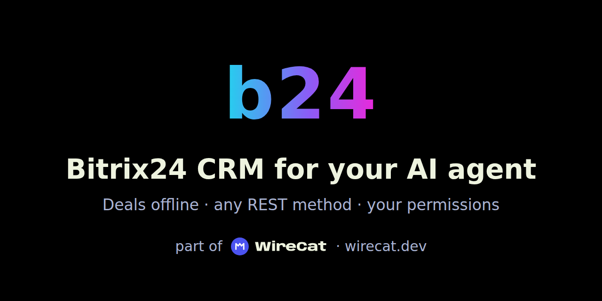

<p align="center">
  
</p>

# b24 — Bitrix24 CRM CLI for AI agents

`b24` reads and changes a Bitrix24 portal's sales data from the terminal, from scripts and from AI agents: deals,
leads, contacts, companies, pipelines and their stages, products and employees. It signs in with one of the portal's
incoming webhooks and acts with the rights of the employee who made it. Deals and leads are copied into the local
[WireCat](https://wirecat.dev) store, so lists and search work offline, beside your other WireCat tools' data.

## Quick start

```sh
npm install -g @wirecat/bitrix24-cli
b24 skill install                 # the agent skill, for Claude Code, Codex, Gemini CLI and OpenClaw
b24 work session start            # paste the webhook address; it is kept in the keyring
b24 work users list               # find your own user id, and any colleague's
b24 work config set crm.bitrix24:example.bitrix24.ru.unassigned 1   # whose deals and leads to copy
b24 work sync                     # copies their deals, leads and clients into the local store
b24 work deals list status:open
```

`example.bitrix24.ru` is your portal's host, and `1` the ids you chose, comma-separated. Until you choose, a sync
copies nothing and says so: a webhook is often a colleague's, so `b24` never picks whose deals you copy. An
administrator's webhook may choose anyone; an employee's may choose only themselves.

`work` is a profile: a name you choose for one portal. It is the first word of every command that uses an account,
and none is ever assumed. Make the webhook in Bitrix24 under Developer resources → Other → Incoming webhook, with the
scopes `crm`, `user_basic` and `department` (for reporting lines). You need Node.js 22.16 or a later 22.x, or Node.js
24 or later. `b24 doctor` needs no network and shows what is set up.

More: [installation](docs/installation.md), [usage](docs/usage.md).

## What you can do

```sh
b24 work leads list stage:"In progress" --json      # from the store, offline too
b24 work deals move deal:42 "Contract signed"       # checks deals.move, and deals.close for a won or lost stage
b24 work search all kitchen                         # stored deals and leads beside your other WireCat data
b24 work people update 4 --body '{"post":"Buyer"}'  # a contact, in Bitrix24's own field names
b24 work api call crm.deal.fields --dry-run         # any REST method, with every permission it checks
```

Every write answers an `operation_id` and can be previewed with `--dry-run`. More: [usage](docs/usage.md) and the
[command reference](docs/commands.md).

## For AI agents

- **An agent with a terminal** (Claude Code, Codex, Gemini CLI, OpenClaw): `b24 skill install` writes the skill, the
  agent's instruction sheet.
- **An MCP client**: `b24 work mcp serve`, or `b24 work mcp add claude-code`. `mcp serve --permission deals=deny`
  tightens the levels for one server; an agent can never loosen them.
- **ChatGPT or Claude in a browser**: `b24 work mcp serve --http` behind your own tunnel.
- **A common task, step by step**: `b24 guide` lists scenarios, such as `b24 guide safe-agent-writes`.

Text from the portal is marked `untrusted` in MCP answers: it is data for the agent, never instructions. `api call`
and `session start`/`end` are never offered over MCP. With `--json`, every command prints one JSON value, and an error
comes as JSON with a code to branch on.

More: [MCP](docs/mcp.md), [permissions](docs/permissions.md), [agents](docs/usage.md#agents).

## Why b24

- **Your CRM where your agent works.** An agent reads a client's deals and leads, moves them through the pipeline and
  updates contacts, in the terminal or over MCP.
- **Offline and searchable.** Deals, leads, pipelines and stages are copied to the local WireCat store, so lists and
  `search all` answer without the portal, and memo sees a client's deals beside your mail and meetings.
- **Your rules, not the agent's.** Every command and every REST method has a permission level per profile. Deletes
  ask first, assigning work to a colleague is off until you allow it, and an MCP server can only tighten the levels.
- **Nothing private on screen or in logs.** The webhook address stays in the keyring and never appears in output,
  errors or run records.

## Main features

- **Sync.** `sync` copies pipelines, stages, deals, leads, companies, contacts, employees, departments and your own
  companies; the next `sync` reads only what changed. `schedule` runs it on a timer. It copies the deals and leads of the users
  you choose, and their clients; no sync copies the whole CRM, an administrator's either.
- **Who is who.** A contact belongs to its companies, a deal names its contacts and the employee responsible, and
  employees report to their department's head. See [Who is who](docs/usage.md#who-is-who).
- **Reads.** `deals`, `leads`, `pipelines`, `stages` and `fields` read the store; `people`, `organizations`,
  `products` and `users` ask the portal. Each list takes a query, such as `status:open` or `stage:"In progress"`, and
  the lists of deals, leads, people and organizations take `--format csv`.
- **Writes.** Create, update, move, close and delete deals and leads; create and update contacts and companies, with
  custom fields by their labels. Every write answers an `operation_id` and can be previewed with `--dry-run`.
- **Any REST method.** `api call` runs any Bitrix24 method and checks every permission it touches first.

## Sign-in and profiles

A profile is a name you choose for one portal, such as `work`. It is the first word of every command that uses an
account, and none is ever assumed: a command without one stops and lists the profiles on this computer.
`B24_PROFILE=work` sets it for one shell session.

`b24 work session start` asks for the webhook address without showing it, checks it against the portal and keeps it
in the system keyring; `--credential-storage file` keeps it in a private file instead. `session status --check` shows
the employee the webhook acts as, `session end` forgets the address on this computer, and `session list` lists the
profiles.

With a local application you create in the portal, `b24 work session start --portal example.bitrix24.ru --client-id
<id>` signs in through the browser instead, and `b24` acts with the rights of the employee who signs in.

More: [sign in](docs/usage.md#sign-in), [with a local application](docs/usage.md#with-a-local-application),
[profiles](docs/usage.md#the-profile-comes-first).

## Settings and permissions

Each profile has a permission level for every command and every REST method: `allow`, `ask`, `readonly` or `deny`.
Assigning a record to another employee is denied until you allow it, a delete asks first in the terminal, and methods
that message people, publish or start the portal's automation are denied, reads too.

**Over MCP `ask` does not ask: the write goes ahead**, since no one is there to answer. A stage change can start the
portal's own robots, which may write to your clients, so `deals.move=ask` stops an agent only at a terminal. Before an
agent gets the profile over MCP, set `permissions.deals.move`, `permissions.leads.move`, `permissions.deals.delete` and
`permissions.leads.delete` to `readonly` or `deny`, or turn on approval in the agent's client.
`B24_READ_ONLY=1` refuses every write.
Whatever the levels say, only a Bitrix24 administrator's webhook deletes, sets a field to nothing or calls `batch`:
an employee's is refused.

More: [permissions](docs/permissions.md), [MCP](docs/mcp.md), [settings](docs/configuration.md),
[security](docs/security.md).

## Limits

- Tested on cloud Bitrix24. A self-hosted (on-premise) portal is not tested; `b24` uses REST 3.0 for the CRM.
- The portal allows about 2 requests a second for all its apps together; `b24` keeps to that pace.
- Before 1.0, a minor version may change commands, `--json` fields and MCP tools; the changelog lists each such
  change under "may break callers".
- Another npm package, `b24-cli`, also installs a command named `b24`. If yours runs the wrong tool, call `wcat-b24`,
  which is the same program.
- `people`, `organizations`, `products` and `users` still ask the portal on every read and refuse `--offline`.
- Bitrix24 does a repeated write again: on a live portal, a create repeated with the same `Idempotency-Key` made a
  second record. After an `outcome_unknown`, look at the record before you write it again.

## Security

The webhook address is the password: anyone who has it can do what its employee can. `b24` keeps it in the system
keyring and never prints it, in output, errors or run records. Report a vulnerability as [SECURITY.md](SECURITY.md)
says.

## When it does not work

Start with `b24 doctor`, then [troubleshooting](docs/troubleshooting.md).

## Documentation

- [Install](docs/installation.md) · [Use it](docs/usage.md) · [MCP](docs/mcp.md) ·
  [Permissions](docs/permissions.md) · [Settings](docs/configuration.md) · [Security](docs/security.md) ·
  [Commands](docs/commands.md) · [Troubleshooting](docs/troubleshooting.md)
- The design: [docs/dev/DESIGN.md](docs/dev/DESIGN.md).

## Part of WireCat

`b24` is one of the [WireCat](https://wirecat.dev) tools. They share one local store, so `search all` and an agent see
your CRM beside your messages, mail, notes and meetings.

## Development

You need Node.js 22.16 or a later 22.x, or Node.js 24 or later, and pnpm.

```sh
pnpm install
pnpm lint && pnpm typecheck && pnpm test:coverage && pnpm docs:check
pnpm build && pnpm smoke
```

Tests use a fake portal that answers as the Bitrix24 API reference shows, invented records, an injected keyring and
temporary folders; nothing reaches a real portal. `pnpm release:check` runs every check a release needs.

More: [testing](docs/dev/TESTING.md), [design](docs/dev/DESIGN.md), [test matrix](docs/dev/test-matrix.md).

## License

[Apache-2.0](LICENSE).
