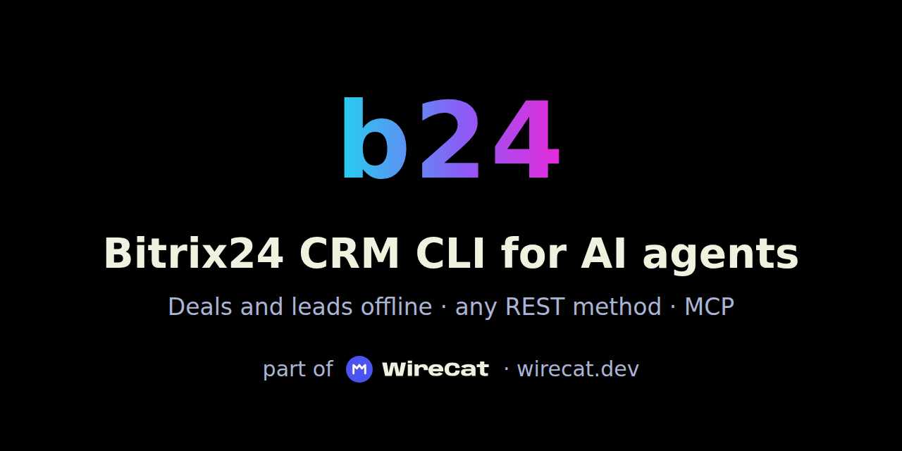

<p align="center">
  
</p>

# b24: Bitrix24 CRM CLI for AI agents

<p align="center">
  Know where every deal stands and what a client said on the phone, without opening Bitrix24. Ask your AI agent, and
  it answers from a copy of your deals on your computer, even offline. It moves and closes deals for you too, as far
  as you allow.
</p>

<p align="center">
  <a href="https://wirecat.dev/en/docs/b24">Docs</a> ·
  <a href="https://github.com/WireCatLabs/bitrix24-cli/blob/main/docs/installation.md">Install</a> ·
  <a href="https://github.com/WireCatLabs/bitrix24-cli/blob/main/docs/usage.md">Usage</a> ·
  <a href="https://t.me/wirecatdev">Telegram</a>
</p>

<p align="center">
  <a href="https://www.npmjs.com/package/@wirecat/bitrix24-cli"></a>
  <a href="https://github.com/WireCatLabs/bitrix24-cli/actions/workflows/main.yml"></a>
  <a href="https://github.com/WireCatLabs/bitrix24-cli/blob/main/LICENSE"></a>
</p>

- **Ask instead of clicking.** "Which deals are stuck in Quote sent?" gets an answer in a second, in Claude Code,
  Codex or any app that speaks MCP.
- **Calls you can read.** The recording of yesterday's call with a client becomes text on your computer, so the agent
  can tell you what was promised.
- **Nothing happens behind your back.** Every action has its own permission. Through `b24`, an agent gives no deal to
  a colleague and messages no client until you allow it.

## What you get

- **The answer, not the search.** Ask about a deal or a client in your own words. The agent finds the deal with its
  amount and owner, read from your computer.
- **The funnel at a glance.** Where deals drop off this month, and why the lost ones were lost.
- **The morning starts with what changed.** Yesterday's wins, losses and moves arrive as a short digest at the time
  you choose.
- **Changes by asking.** "Move Kitchen for Example to Contract signed" is enough. The agent finds the stage by its
  name.

```text
You:    Which of my deals are in Quote sent?
Agent:  (runs b24 work deals list stage:"Quote sent" owner:me)
        · "Kitchen for Example", 15 000 EUR
        · "Office for Sample", 8 200 EUR
You:    Move Kitchen for Example to Contract signed.
Agent:  (runs b24 work deals move deal:42 "Contract signed")
        Done. "Kitchen for Example" is in Contract signed now.
```

*Invented deals, illustrative output.*

## Why b24

- **A copy of your deals on your computer.** `sync` copies your deals and leads with their clients, pipelines and
  stages, and the next sync takes only the changes. Lists, the funnel and search then answer with no request to the
  portal, also offline. None of the other tools in the comparison documents a copy like this.
- **A permission on every action.** Each command and each Bitrix24 method has its own level: allow, ask, read only or
  deny. Methods that message people or start workflows, and giving a record to another employee, are refused until
  you allow them. `B24_READ_ONLY=1` stops every write.
- **Writes you can check first.** `--dry-run` shows what a write would do and every permission it checks, and sends
  nothing. A write that got no answer is never sent again on its own, so a lost connection makes no second deal.
- **The webhook stays in the system keyring.** Its address is the password, and it never appears in output, errors
  or run records.
- **Your CRM beside your other context.** Deals sit in the same local store as your messages, mail, notes and
  meetings from the other WireCat tools, so one search covers all of them.
- **Free and open source.** Apache 2.0.

How it compares with other Bitrix24 tools and MCP servers: [the comparison](https://wirecat.dev/en/docs/b24/compare).
Another tool fits better when you want Bitrix24 in ChatGPT or Claude in the browser with nothing to run on your
computer, or more of Bitrix24 than sales data, such as tasks, chats and workflows.

## Quick start

```sh
npm install -g @wirecat/bitrix24-cli
b24 skill install                  # the agent skill, for Claude Code, Codex, Gemini CLI and OpenClaw
b24 work setup                     # make an inbound webhook in Bitrix24, tick its permissions, paste its address
b24 work sync                      # copy your deals, leads and their clients
b24 work deals list status:open
```

`work` is a profile, a name you choose for one portal. It is the first word of every command that uses an account,
and none is ever assumed. `b24 work setup` shows each step in Bitrix24 and which permissions (scopes) to tick, checks
the address against the portal and keeps it in the system keyring. A sync copies the deals and leads of the employee
the webhook belongs to. To copy a colleague's instead, see
[whose deals and leads](https://wirecat.dev/en/docs/b24/usage#whose-deals-and-leads).

You need Node.js 22.16 or a later 22.x, or Node.js 24 or later. `b24 doctor` needs no network and shows what is set
up.

More: [installation](https://wirecat.dev/en/docs/b24/installation), with sign-in through a local application.

## Use it with your agent

Ask in plain words. The agent picks the commands.

> *"Use b24. What changed in the CRM since yesterday?"*
> *"Use b24. How did the Sales funnel do in the last 30 days, and why did we lose deals?"*
> *"Use b24. Who works at Example LLC, and what deals do we have open with them?"*

- **Claude Code, Codex, Gemini CLI** and other agents with a terminal run `b24` themselves. `b24 skill install`
  teaches them how.
- **Claude Desktop, Cursor** and other MCP apps connect to `b24 work mcp serve`.
- **ChatGPT or Claude in the browser** reach it through your own tunnel, after a login with a one-time code.

```sh
b24 work mcp add claude-code --allow-writes   # or: codex
b24 work mcp config                           # the entry for Claude Desktop, Cursor and others
```

Over MCP nobody is at a terminal to answer a question, so a write set to `ask` goes ahead. Before an agent gets the
profile over MCP, set the writes it must not make to `readonly` or `deny`, or turn on approval in the agent's client.

More: [agents and MCP](https://wirecat.dev/en/docs/b24/mcp) · [permissions](https://wirecat.dev/en/docs/b24/permissions)

## What it can do

### Deals and leads

```sh
b24 work deals list stage:"Quote sent" pipeline:Sales
b24 work deals show deal:42                      # one deal, with the stages it passed
b24 work deals create --title "Kitchen for Example" --pipeline Sales --amount 15000 --currency EUR
b24 work deals move deal:42 "Contract signed"
b24 work deals close deal:42 won
b24 work leads list status:open --format csv > leads.csv
```

Leads work the same way. `--field` sets your portal's own fields by their label or code, and every write can be
previewed with `--dry-run`.

More: [using b24](https://wirecat.dev/en/docs/b24/usage)

### The funnel

```sh
b24 work pipelines show Sales                    # each stage: how many, their sum, how many went on
b24 work pipelines show Sales --since-time 30d   # the last 30 days: closed deals, time to close, lost reasons
```

### Contacts, companies and employees

```sh
b24 work people show "Anna Ivanova"
b24 work organizations list type:CUSTOMER
b24 work people create --first-name Anna --last-name Ivanova --email anna@example.com
b24 work users list
```

These read the portal itself, so they need the network. Lists give the phones and e-mails of your own clients. For
anyone else's, `show` gives them, at most 100 such contacts and companies a day.

### Calls

```sh
b24 work meetings sync                 # the portal's calls, also part of every sync
b24 models download gigaam-v3          # once: the speech model, a few hundred megabytes
b24 work meetings transcribe           # recordings into text, on this computer
b24 work meetings transcript 12
```

The webhook needs the `telephony` scope. `calls export` writes the calls of another phone system onto the client's
contact in Bitrix24, once each, and stays off until you turn it on.

More: [calls](https://github.com/WireCatLabs/bitrix24-cli/blob/main/docs/calls.md)

### What changed, and the morning digest

```sh
b24 work changes list "at>=1d"         # deals made, moved, won and lost, tasks, new contacts
b24 work schedule command morning --at 08:00 -- changes list "at>=1d" --format report
```

The second line makes a digest of the last day every morning at 8 and shows it as a desktop notice. `--deliver-to`
also sends it to your Telegram or mailbox through your own `tg` or mail tool.

### Tasks and activities on a deal

With `activities` on, each sync also reads the calls, e-mails, meetings, to-dos, Bitrix24 tasks and timeline
comments on your deals and leads, and `deals show` lists them. `stage-tasks` opens a task on your computer each time
a deal enters a stage you name.

More: [activities and tasks](https://github.com/WireCatLabs/bitrix24-cli/blob/main/docs/usage.md#activities-and-tasks-on-a-deal) ·
[a task when a deal enters a stage](https://wirecat.dev/en/docs/b24/usage#a-task-when-a-deal-enters-a-stage)

### Any Bitrix24 method

```sh
b24 work api call crm.deal.get --body '{"id":42}'
b24 work api show crm.deal.update      # the permissions a method checks
```

`api call` checks the same permissions as the command that does the same thing. It is for you at a terminal, and no
MCP tool offers it.

## How it works

- **A webhook or a local application.** An inbound webhook acts with the rights of the employee who made it. A local
  application you create in the portal acts as the employee who signs in through the browser, and `b24` renews its
  tokens by itself. Either is kept in the system keyring, or in a private file on a computer without one.
- **A copy, never the whole CRM.** `sync` copies the deals and leads of the webhook's employee, or of the users you
  choose, with their clients, pipelines, stages and employees. The next sync reads only what changed. A timer
  (`b24 work schedule command crm --every 1h -- sync`) keeps it current.
- **Who is who.** A contact belongs to its companies, a deal names its contacts and owner, and employees report to
  their department's head. Every WireCat tool reads these relationships from the same store.
- **Polite to the portal.** Bitrix24 allows about 2 requests a second for all its apps together, and `b24` keeps to
  that pace.
- **No double writes.** When the connection drops during a write, `b24` says the outcome is unknown and does not
  send it again. Look at the record before you write it again.
- **Made for scripts.** `--json` prints one JSON value for every command, and an error comes as JSON with a code to
  branch on.

More: [who is who](https://wirecat.dev/en/docs/b24/usage#who-is-who) ·
[commands](https://wirecat.dev/en/docs/b24/commands)

## Settings and permissions

Each profile has a level for every command and every Bitrix24 method: `allow`, `ask`, `readonly` or `deny`. A delete
asks first at a terminal. Only a Bitrix24 administrator's webhook deletes or clears a field at all.

```sh
b24 work config set permissions.deals.move readonly   # no agent moves a deal on this profile
b24 work config show                                  # each setting and where it came from
```

A stage change can start the portal's own robots, which may write to your clients. If your portal has such robots,
decide who may move a deal before an agent gets the profile.

More: [permissions](https://wirecat.dev/en/docs/b24/permissions) · [settings](https://wirecat.dev/en/docs/b24/configuration)

## Limits

- Tested on cloud Bitrix24. A self-hosted (on-premise) portal is not tested. `b24` uses REST 3.0 for the CRM.
- `b24` needs the portal's REST API. A cloud portal has it on Bitrix24's Vibe+ plans or for the 15-day trial, and the
  Essentials plans do not include it ([Bitrix24's page](https://apidocs.bitrix24.com/first-steps/access-to-rest-api.html)).
- `people`, `organizations`, `products` and `users` ask the portal on every read and refuse `--offline`.
- Bitrix24 makes a repeated write a second time, even with the same `Idempotency-Key`. After `outcome_unknown`, look
  at the record before you write it again.
- Another npm package, `b24-cli`, also installs a command named `b24`. If yours runs the wrong tool, call `wcat-b24`,
  which is the same program.
- Before 1.0, a minor version may change commands, `--json` fields and MCP tools. The changelog lists each such
  change under "may break callers".

## Security

The webhook's address is the password: anyone who has it can do what its employee can. `b24` keeps it in the system
keyring and never prints it, in output, errors or run records. A file in a CRM field is kept as its file id, never
as Bitrix24's download link, which carries an access token. Text from the portal is marked as untrusted, so an agent
reads a deal title or a comment as data, not as an instruction.

More: [security](https://wirecat.dev/en/docs/b24/security) · Report a vulnerability:
[SECURITY.md](https://github.com/WireCatLabs/bitrix24-cli/blob/main/SECURITY.md)

## When something goes wrong

```sh
b24 doctor                         # what is set up, without connecting
b24 work session status --check    # the employee the webhook acts as
```

More: [troubleshooting](https://wirecat.dev/en/docs/b24/troubleshooting) · Ask on
[Discord](https://discord.gg/DebENqbRrJ) · Bugs go to this repository's issues.

## Documentation

Everything is on [wirecat.dev/en/docs/b24](https://wirecat.dev/en/docs/b24). The same pages are in
[docs/](https://github.com/WireCatLabs/bitrix24-cli/blob/main/docs/index.md).

## Development

You need Node.js 22.16 or a later 22.x, or Node.js 24 or later, and pnpm.

```sh
pnpm install && pnpm test
```

Tests use a fake portal that answers as the Bitrix24 API reference shows, with invented records, and nothing reaches
a real portal.

More: [design](https://github.com/WireCatLabs/bitrix24-cli/blob/main/docs/dev/DESIGN.md) ·
[testing](https://github.com/WireCatLabs/bitrix24-cli/blob/main/docs/dev/TESTING.md)

Pull requests, bug reports and ideas go to [issues](https://github.com/WireCatLabs/bitrix24-cli/issues).

## Part of WireCat

`b24` is one of the [WireCat](https://wirecat.dev) tools: open-source, local-first command-line tools that give AI
agents your context from messengers, mail, calendars, CRMs and documents. Each one works on its own.

## License

[Apache 2.0](https://github.com/WireCatLabs/bitrix24-cli/blob/main/LICENSE)
